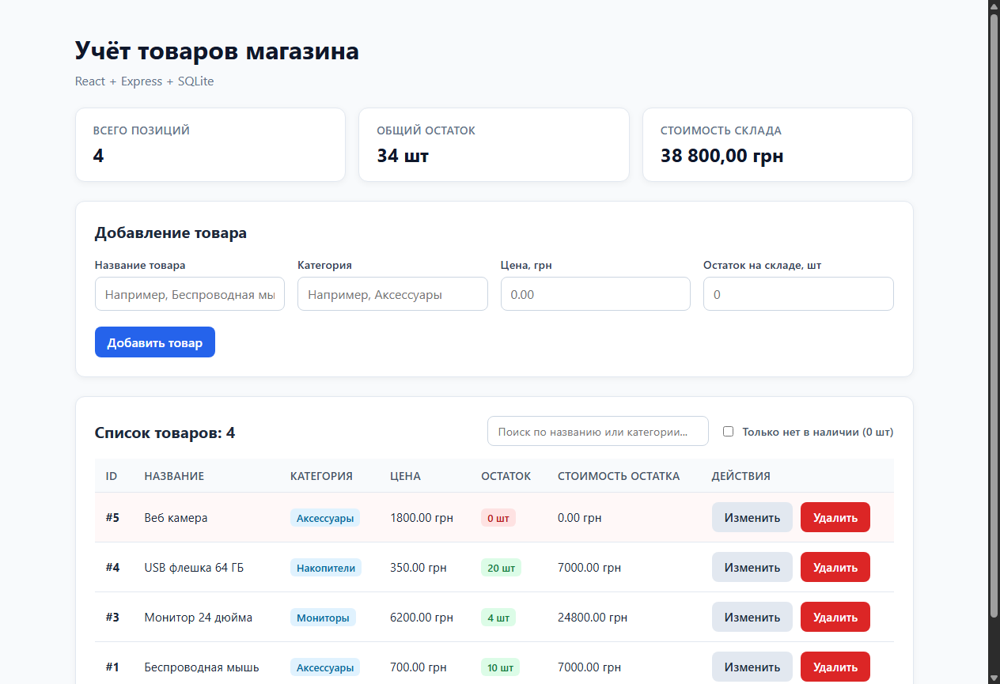
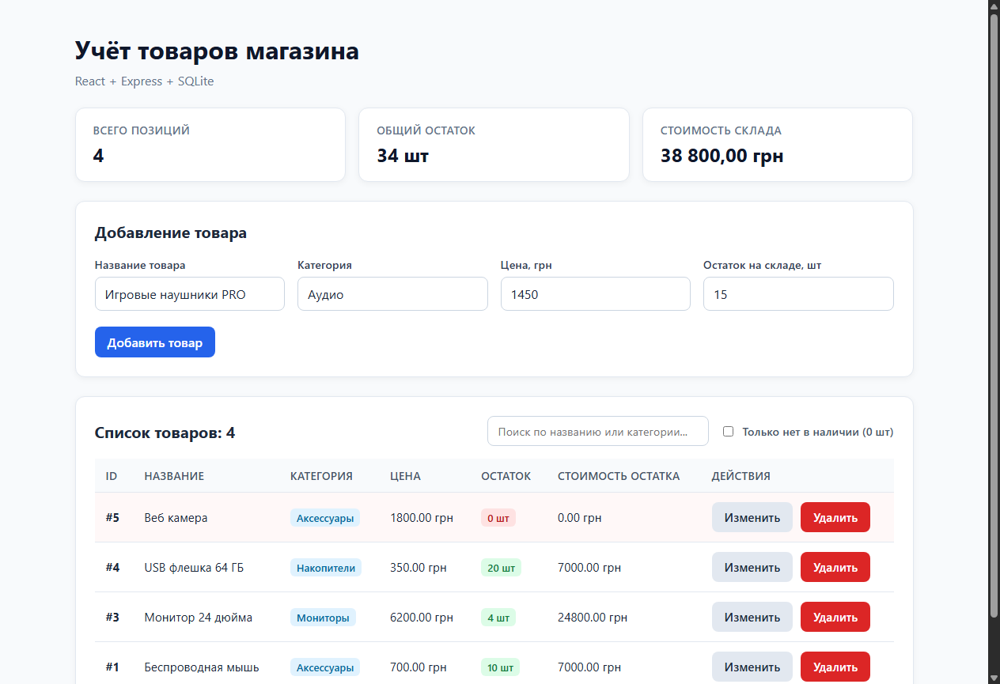
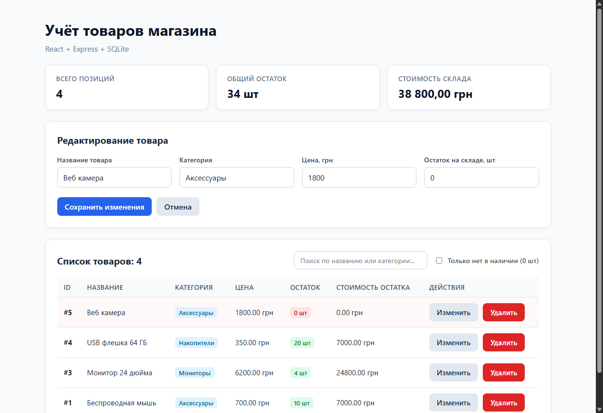
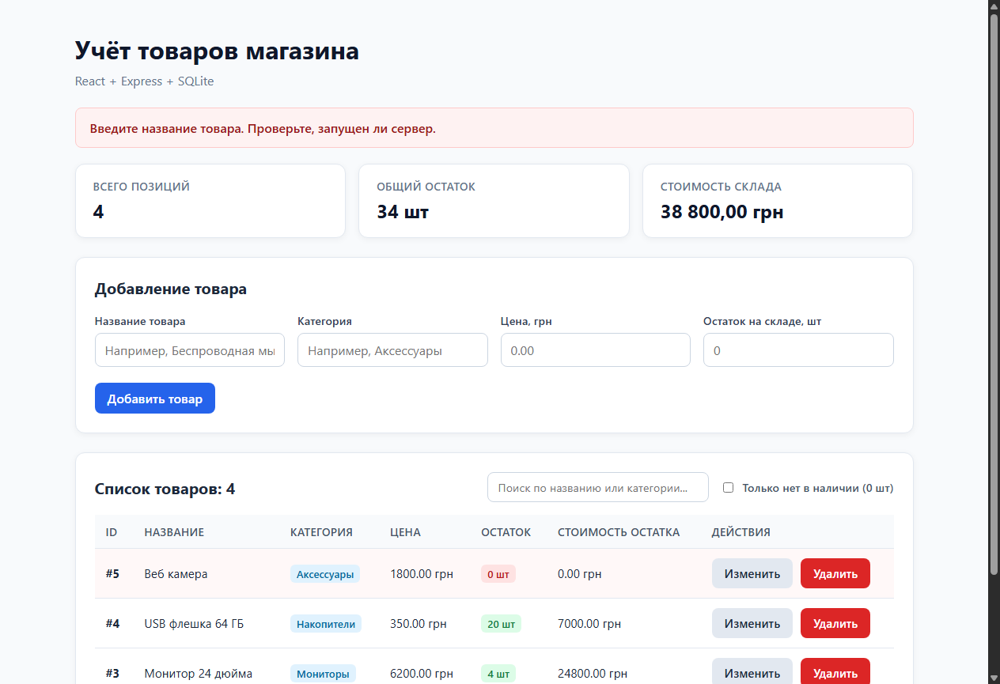

# Отчёт о практической работе
## «Учёт товаров магазина» (React + Express + SQLite)

**Стек технологий:**
- **Клиент:** React 19, Vite, HTML5, CSS3, JavaScript (Fetch API)
- **Сервер:** Node.js 24.x, Express 5, CORS
- **База данных:** SQLite (встроенный модуль `node:sqlite` — `DatabaseSync`)

---

## 1. Архитектура и структура базы данных

### Структура таблицы `products` в файле `server/store.db`:
| Поле | Тип SQLite | Ограничения | Описание |
|---|---|---|---|
| `id` | `INTEGER` | `PRIMARY KEY AUTOINCREMENT` | Уникальный автоинкрементный идентификатор товара |
| `name` | `TEXT` | `NOT NULL` | Название товара (не пустое после `.trim()`) |
| `category` | `TEXT` | `NOT NULL` | Категория товара (не пустая после `.trim()`) |
| `price` | `REAL` | `NOT NULL CHECK(price >= 0)` | Цена товара в грн (число >= 0) |
| `quantity` | `INTEGER` | `NOT NULL CHECK(quantity >= 0)` | Остаток товара на складе, целое число >= 0 |

### Контракт REST API (`http://localhost:3001`):
- `GET /api/products` — получение всех товаров с сортировкой по `id DESC` (код 200).
- `POST /api/products` — создание нового товара с валидацией данных (код 201, возвращает `{ id }`).
- `PUT /api/products/:id` — обновление товара по ID с валидацией (код 200 либо 404, если ID не найден).
- `DELETE /api/products/:id` — удаление товара по ID (код 200 либо 404, если ID не найден).

---

## 2. Результаты выполнения 14 сценариев проверки

| № | Действие | Ожидаемый результат | Фактический результат | Статус |
|---|---|---|---|:---:|
| **1** | Первый запуск с новой базой | Пустой список, доступна форма | Сервер возвращает `[]`, в интерфейсе отображается пустой список и доступна форма добавления | **Пройден** (Совпало) |
| **2** | Добавить пять товаров со страницы задания | В таблице пять строк, ID различаются. Суммарный остаток 44 шт, стоимость 49 200 грн | Добавлены 5 товаров: Беспроводная мышь, Клавиатура, Монитор 24", USB флешка 64 ГБ, Веб камера. Всего: 44 шт, 49 200.00 грн | **Пройден** (Совпало) |
| **3** | Обновить страницу браузера | Все пять записей сохранены | При перезагрузке страницы и повторном GET-запросе все 5 записей загружены из SQLite | **Пройден** (Совпало) |
| **4** | Изменить цену мыши на 700 и остаток на 10 | Та же запись и ID; стоимость остатка 7000 грн | Товар обновлён без изменения ID; стоимость остатка пересчитана: 700 × 10 = 7000.00 грн | **Пройден** (Совпало) |
| **5** | Начать изменение, затем нажать Отмена | Форма очищена, база не изменена | Поля формы сброшены, `editingId` установлен в `null`, запись в базе осталась прежней | **Пройден** (Совпало) |
| **6** | Удалить клавиатуру и подтвердить | Клавиатура удалена, осталось четыре товара | DELETE-запрос успешно выполнен, в таблице и базе осталось ровно 4 товара | **Пройден** (Совпало) |
| **7** | Отказаться от удаления другого товара | Товар остался в таблице | При нажатии «Отмена» в модальном окне `window.confirm` запрос DELETE не отправляется, товар сохранён | **Пройден** (Совпало) |
| **8** | Остановить и запустить сервер | Оставшиеся 4 товара доступны | После полного перезапуска процесса Node.js данные из `store.db` успешно прочитаны и отображены | **Пройден** (Совпало) |
| **9** | Отправить POST с пустым `name` через API | Код 400 и JSON с `message`; запись не добавлена | Получен ответ 400 Bad Request: `{"message": "Введите название товара"}`. В базе запись не создана | **Пройден** (Совпало) |
| **10** | Отправить `price = -1` или `quantity = 1.5` | Код 400; данные не сохранены | Оба запроса отклонены сервером с кодом 400 и поясняющими сообщениями валидации | **Пройден** (Совпало) |
| **11** | Добавить товар с `price = 0` и `quantity = 0` | Добавление разрешено (код 201) | Сервер вернул 201 Created; нулевая цена и нулевой остаток корректно приняты и сохранены | **Пройден** (Совпало) |
| **12** | PUT и DELETE для несуществующего ID (например, 99999) | Код 404 и понятное сообщение | Получен статус 404 Not Found: `{"message": "Товар не найден"}` | **Пройден** (Совпало) |
| **13** | Передать `id = abc` | Код 400; сервер продолжает работать | Получен статус 400 Bad Request: `{"message": "Некорректный ID"}`. Сервер не упал, обработал следующие запросы | **Пройден** (Совпало) |
| **14** | Остановить сервер и отправить форму | Ошибка видна в интерфейсе, кнопка разблокирована | Ошибка сети перехвачена в блоке `catch`, баннер ошибки отображён на экране, `busy` сброшен в `false` | **Пройден** (Совпало) |

---

## 3. Скриншоты работы приложения

### Скриншот 1: Список товаров с итоговыми показателями склада
Отображение таблицы товаров, бейджей категорий, цветовой индикации остатков (красный бейдж для 0 шт) и карточек сводки склада.

### Скриншот 2: Форма добавления нового товара
Заполнение полей формы валидными значениями перед отправкой на сервер.

### Скриншот 3: Режим редактирования товара
Переход формы в режим обновления: заголовок «Редактирование товара», кнопка «Сохранить изменения» и кнопка «Отмена».

### Скриншот 4: Отображение ошибок
Обработка ошибок валидации и сетевых сбоев с информативным уведомлением пользователя.

---

## 4. Ответы на контрольные вопросы

### 1. Зачем между React и SQLite нужен сервер?
React выполняется в браузере клиента (на стороне пользователя в изолированной «песочнице»). Браузер не имеет прямого доступа к файловой системе операционной системы и не может напрямую открывать файлы локальной базы данных SQLite (`store.db`). Кроме того, прямое подключение базы к клиенту представляло бы критическую угрозу безопасности: любой пользователь мог бы выполнить произвольный SQL-запрос. Сервер на Express выступает безопасным посредником: он реализует единую бизнес-логику, валидацию данных, контроль доступа и выполняет авторизованные SQL-запросы к базе данных.

### 2. Чем состояние `products` в React отличается от таблицы `products` в базе данных?
- Состояние `products` (`useState`) хранится исключительно в оперативной памяти браузера в виде массива JavaScript-объектов. Оно существует только пока открыта вкладка, и при обновлении страницы или перезагрузке браузера сбрасывается.
- Таблица `products` в SQLite хранится на диске сервера в постоянном файле `store.db`. Данные в ней персистентны: они сохраняются при перезагрузках страницы, перезапусках сервера и выключениях компьютера.

### 3. Зачем нужны `JSON.stringify`, `express.json` и `response.json`?
- `JSON.stringify(object)` на клиенте сериализует JavaScript-объект в строку формата JSON для передачи по протоколу HTTP через тело сетевого запроса.
- `express.json()` — это middleware на сервере Express. Он перехватывает входящие запросы с заголовком `Content-Type: application/json`, считывает текстовый поток байтов, парсит его из JSON и помещает готовый JavaScript-объект в `request.body`.
- `response.json(data)` на сервере автоматически устанавливает заголовок `Content-Type: application/json`, сериализует переданные серверные данные в формат JSON и отправляет их клиенту в теле HTTP-ответа.

### 4. Почему цену и количество нужно преобразовать из строк в числа?
HTML-элементы `<input>` (даже с атрибутом `type="number"`) возвращают своё значение через свойство `event.target.value` в виде **строки** (например, `"650"`, `"12"`). Если не преобразовать их в числа:
1. В JavaScript сложение строк приводит к конкатенации (`"650" + "12" = "65012"` вместо арифметического сложения).
2. На сервере валидация типов (`typeof product.price !== 'number'`) отклонит запрос.
3. В базе данных SQLite числа могут сохраниться как текстовый тип (TEXT), что сломает математические операции и числовые сравнения в ограничениях `CHECK(price >= 0)`.

### 5. Чем отличаются POST и PUT в этом приложении?
- **POST `/api/products`** предназначен для **создания** нового ресурса. Клиент не передаёт `id` — идентификатор автоматически генерируется базой данных (`PRIMARY KEY AUTOINCREMENT`), а сервер возвращает статус `201 Created` с присвоенным `id`.
- **PUT `/api/products/:id`** предназначен для **полного обновления** уже существующего ресурса с известным идентификатором `id`. Сервер проверяет наличие записи (`result.changes > 0`) и в случае её отсутствия возвращает статус `404 Not Found`.

### 6. Почему проверки React не заменяют проверки сервера?
Проверки в браузере (React) созданы для удобства пользователя (UX) — чтобы мгновенно подсказать об ошибке ввода без лишнего сетевого запроса. Однако проверки клиента легко обойти: злоумышленник или тестировщик может отправить запрос напрямую через Postman, cURL, консоль разработчика или сторонний скрипт, минуя форму React. Сервер — это доверенный рубеж обороны системы: только серверная валидация гарантирует целостность и безопасность данных в базе.

### 7. Как параметры `?` помогают безопасно передавать значения в SQL?
Символ `?` в подготовленных запросах (`Prepared Statements`) отделяет SQL-инструкции от пользовательских данных. СУБД SQLite сначала компилирует структуру SQL-команда, а затем безопасно подставляет значения параметров. Это полностью исключает атаки типа **SQL Injection**: любые специальные символы, кавычки или фрагменты SQL-команд, введённые пользователем, воспринимаются СУБД исключительно как буквальные строковые или числовые литералы, а не как исполняемый код.

### 8. Как определить, что UPDATE или DELETE не нашёл запись?
В объекте результата выполнения подготовленного запроса `result = database.prepare(...).run(...)` свойство `result.changes` содержит число строк, которые были затронуты выполненной SQL-командой.
- Если `result.changes === 0`, значит в таблице не существовало строки с указанным `id`, удовлетворяющим условию `WHERE id = ?`. В этом случае сервер возвращает статус `404 Not Found` с сообщением `Товар не найден`.
- Если `result.changes > 0`, операция завершилась успешно, и сервер возвращает статус `200 OK`.

---

## 5. Дополнительные возможности приложения
В соответствии с блоком дополнительных заданий в проект внедрены:
1. **Быстрый поиск** по названию и категории товара в режиме реального времени.
2. **Фильтр «Только нет в наличии»** (товары с остатком 0 шт) с выделением строки и красным бейджем.
3. **Информационная сводка склада**: карточки с автоподсчётом общего числа позиций, общего остатка единиц и совокупной стоимости товарных запасов на складе.
